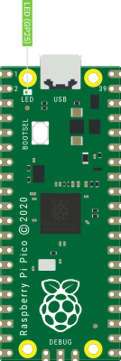
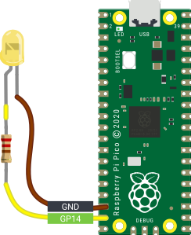
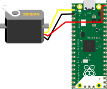
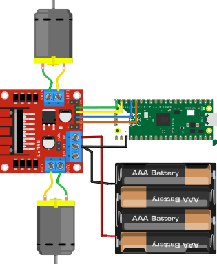
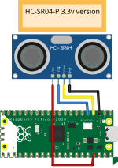

Recipes
=======

The recipes provide examples of how you can use picozero.

Importing picozero
-------------------

.. currentmodule:: picozero

You will need add an `import` line to the top of your script to use picozero.

You can import just what you need, separating items with a comma ``,``::

    from picozero import pico_led, LED

Now you can use :obj:`~picozero.pico_led` and :class:`~picozero.LED` in your script::

    pico_led.on() # Turn on the LED on the Raspberry Pi Pico
    led = LED(14) # Control an LED connected to pin GP14 
    led.on()
 
Alternatively, the whole picozero library can be imported::

    import picozero

In this case, all references to picozero items must be prefixed::

    picozero.pico_led.on()
    led = picozero.LED(14)

Pico LED
--------

To turn on the LED on your Raspberry Pi Pico:

.. literalinclude:: examples/pico_led.py

Run your script to see the LED turn on.

Using :obj:`pico_led` is equivalent to::

    pico_led = LED("LED", pwm=False)

On a Raspberry Pi Pico or Pico 2 the LED is connected to GP25. On a Pico W or Pico 2 W it is connected to the wireless chip, so it can't be controlled with PWM.

You can use :obj:`pico_led` in the same way as external LEDs created using :class:`LED`.

Pin out
-------

You can output a *diagram* of the Raspberry Pi Pico which displays its pins and their numbers.

.. literalinclude:: examples/print_pinout.py

::

            ---usb---
    GP0  1  |o     o| 40  VBUS
    GP1  2  |o     o| 39  VSYS
    GND  3  |o     o| 38  GND
    GP2  4  |o     o| 37  3V3_EN
    GP3  5  |o     o| 36  3V3(OUT)
    GP4  6  |o     o| 35           ADC_VREF
    GP5  7  |o     o| 34  GP28     ADC2
    GND  8  |o     o| 33  GND      AGND
    GP6  9  |o     o| 32  GP27     ADC1
    GP7  10 |o     o| 31  GP26     ADC0
    GP8  11 |o     o| 30  RUN
    GP9  12 |o     o| 29  GP22
    GND  13 |o     o| 28  GND
    GP10 14 |o     o| 27  GP21
    GP11 15 |o     o| 26  GP20
    GP12 16 |o     o| 25  GP19
    GP13 17 |o     o| 24  GP18
    GND  18 |o     o| 23  GND
    GP14 19 |o     o| 22  GP17
    GP15 20 |o     o| 21  GP16
            ---------

LEDs
------
 

You can control external LEDs with a Raspberry Pi Pico.

Flash
~~~~~

Turn an :class:`LED` on and off:

.. literalinclude:: examples/led_on_off.py

Toggle an :class:`LED` to turn it from on to off or off to on:

.. literalinclude:: examples/led_toggle.py

Alternatively, you can use the :meth:`~picozero.LED.blink` method.

.. literalinclude:: examples/led_blink.py

Brightness
~~~~~~~~~~

Set the brightness of an :class:`LED`:

.. literalinclude:: examples/led_brightness.py

Create a pulse effect:

.. literalinclude:: examples/led_pulse.py

Alternatively, you can use the :meth:`~picozero.LED.pulse` method.

.. literalinclude:: examples/led_pulse_method.py

Buttons
-------

You can connect buttons and switches to a Raspberry Pi Pico and detect when they are pressed. 

Check if a :class:`Button` is pressed:

.. literalinclude:: examples/button_is_pressed.py

Run a function every time a :class:`Button` is pressed:

.. literalinclude:: examples/button_function.py

.. note::

    The line ``button.when_pressed = led_on_off`` does not run the
    function ``led_on_off``, rather it creates a reference to the function to be
    called when the button is pressed. Accidental use of ``button.when_pressed
    = led_on_off()`` would set the ``when_pressed`` action to :data:`None` (the
    return value of this function), which would mean nothing happens when the
    button is pressed.

Turn the :obj:`pico_led` on when a :class:`Button` is pressed and off when it is released:

.. literalinclude:: examples/button_led.py

Touch sensor
------------

Detect touch using a capacitive touch sensor:

.. literalinclude:: examples/touch_sensor.py

Use callbacks to respond to touch events:

.. literalinclude:: examples/touch_sensor_callbacks.py

Motion sensor
-------------

Detect motion using a PIR (Passive Infrared) sensor:

.. literalinclude:: examples/motion_sensor.py

Use callbacks to respond to motion events:

.. literalinclude:: examples/motion_sensor_callbacks.py

RGB LEDs
--------

Set colours with an :class:`RGBLED`:

.. literalinclude:: examples/rgb_led.py

Use :meth:`~picozero.RGBLED.toggle` and :meth:`~picozero.RGBLED.invert`:

.. literalinclude:: examples/rgb_toggle_invert.py

Blink
~~~~~

Use :meth:`~picozero.RGBLED.blink` blink to change between colours. You can control which colours are used and how long the LED is set to each colour. The colour `(0, 0, 0)` represents off. 

You can control whether :meth:`~picozero.RGBLED.blink` runs a fixed number of times and whether it waits until it has finished or returns immediately so other code can run.

.. literalinclude:: examples/rgb_blink.py

Pulse
~~~~~

Use :meth:`~picozero.RGBLED.pulse` to gradually change the LED colour. The default will pulse between red and off, then green and off, then blue and off. 

.. literalinclude:: examples/rgb_pulse.py

Cycle
~~~~~

The default for :meth:`~picozero.RGBLED.cycle` is to cycle from red to green, then green to blue, then blue to red. 

.. literalinclude:: examples/rgb_cycle.py

Potentiometer
-------------

Print the value, voltage, and percent reported by a potentiometer:

.. literalinclude:: examples/potentiometer.py

.. note::

    In the Thonny Python editor, choose **View** > **Plotter** to plot the output of :meth:`print`. 

Use a potentiometer to control the brightness of an LED:

.. literalinclude:: examples/pot_led.py

Buzzer
------

Control an active buzzer that plays a note when powered:

.. literalinclude:: examples/buzzer.py

Speaker
-------

Control a passive buzzer or speaker that can play different tones or frequencies:

.. literalinclude:: examples/speaker.py

Play a tune
~~~~~~~~~~~

Play a tune of note names and durations in beats: 

.. literalinclude:: examples/speaker_tune.py

Play individual notes
~~~~~~~~~~~~~~~~~~~~~

Play individual notes and control the timing or perform another action:

.. literalinclude:: examples/speaker_notes.py

Servo
-----

A servo motor connected to a GP pin, VBUS and ground. Most servos need 5V, and the current they draw can be too much for the Pico's 3.3V supply, so use VBUS (pin 40), which is 5V when the Pico is powered over USB.

Move the servo to its minimum, mid and maximum positions.

.. literalinclude:: examples/servo_move.py

Pulse the servo between its minimum and maximum position.

.. literalinclude:: examples/servo_pulse.py

Move the servo gradually from its minimum to maximum position in 100 increments.

.. literalinclude:: examples/servo_sweep.py

Motor
-----

Move a motor connected via two pins (forward and backward) and a motor controller board:

.. literalinclude:: examples/motor_move.py

Robot rover
-----------

Make a simple two-wheeled robot rover.

Move the rover forward for 1 second and stop:

.. literalinclude:: examples/robot_rover_forward.py

Move the rover (roughly) in a square:

.. literalinclude:: examples/robot_rover_square.py

Stepper motor
-------------

Control a stepper motor connected via a driver board (e.g. ULN2003).

Analog clock
~~~~~~~~~~~~

Create a continuously-running analog clock second hand:

.. literalinclude:: examples/stepper_analog_clock.py

Automatic blinds
~~~~~~~~~~~~~~~~

Time-based blind controller:

.. literalinclude:: examples/stepper_automatic_blinds.py

Internal temperature sensor
---------------------------

Check the internal temperature of the Raspberry Pi Pico in degrees Celsius:

.. literalinclude:: examples/pico_temperature.py

Ultrasonic distance sensor
--------------------------

Get the distance in metres from an ultrasonic distance sensor (HC-SR04):

Use the 3.3V version of the sensor (HC-SR04P), as in the diagram, or a voltage divider on the ECHO pin: the 5V signal from a 5V HC-SR04 can damage the Pico.

.. literalinclude:: examples/ultrasonic_distance_sensor.py
